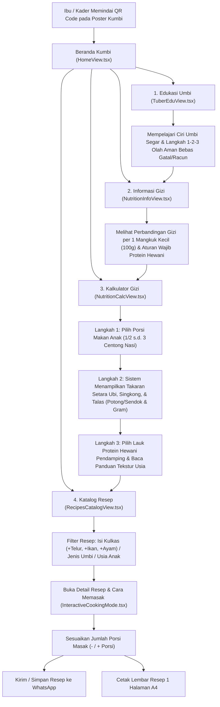
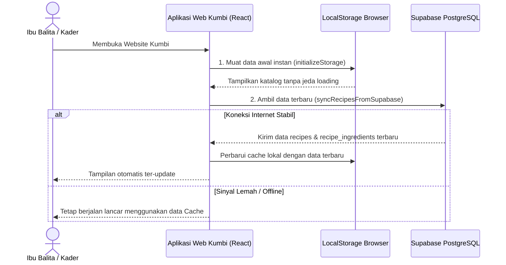
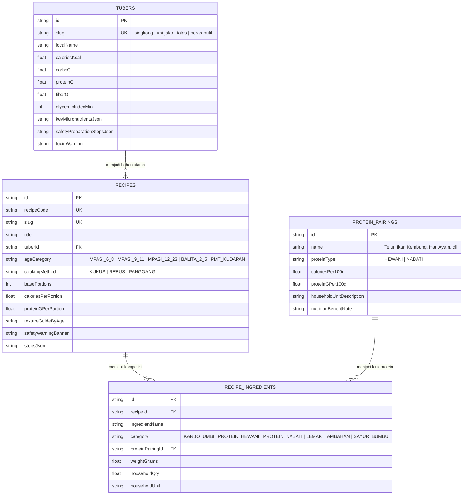

# Dokumen Blueprint & Proses Bisnis Platform Kumbi

**Nama Platform:** Kumbi — Dapur Edukasi Gizi & Resep Olahan Umbi Posyandu  
**Target Utama:** Ibu Balita, Ibu Rumah Tangga, dan Kader Posyandu  
**Fokus Komoditas:** Ubi Jalar, Singkong (termasuk Tepung Mocaf), dan Talas  

> [!IMPORTANT]
> Dokumen blueprint ini disusun selaras 100% dengan media publikasi poster **"Apa itu Kumbi"** serta prinsip desain ramah pengguna awam teknologi (*low-tech literacy & mobile-first*).

---

## 1. Visi Produk & Latar Belakang Masalah

**Kumbi** adalah website edukasi gizi dan katalog resep olahan **Singkong, Ubi Jalar, dan Talas** sebagai alternatif pendamping beras terstandarisasi yang terintegrasi dengan program Pemberian Makanan Tambahan (PMT) Posyandu dan protokol wajib protein hewani.

### Masalah Utama yang Diselesaikan:
1. **Ketergantungan Beras & Anak Bosan Makan (GTM):** Mayoritas keluarga hanya mengandalkan nasi putih sebagai sumber karbohidrat tunggal, padahal umbi lokal memiliki serat 4–6 kali lebih tinggi serta rasa dan tekstur alami yang disukai anak.
2. **Kekhawatiran Keamanan Pengolahan Umbi:** Banyak ibu ragu mengolah talas karena takut getahnya membuat gatal (kalsium oksalat) atau khawatir pada singkong pahit.
3. **Risiko Stunting Akibat Menu Hanya Karbohidrat:** Pemberian olahan umbi tanpa lauk pendamping berisiko kurang protein karena protein alami umbi rendah ($1{,}0\text{--}1{,}57\text{ g per }100\text{g}$).
4. **Kesulitan Menentukan Takaran Porsi:** Ibu-ibu kesulitan mengira-ngira berapa potong/sendok umbi kukus yang setara energinya dengan centong nasi yang biasa dimakan anak.

---

## 2. Profil Pengguna & Pemangku Kepentingan (Stakeholders)

| Peran | Karakteristik Pengguna | Kebutuhan Utama pada Sistem |
| :--- | :--- | :--- |
| **Ibu Balita / Ibu Rumah Tangga** *(Pengguna Utama)* | Mengakses web melalui *smartphone*, membutuhkan tampilan sederhana, huruf jelas, tanpa istilah ilmiah yang rumit, dan menggunakan satuan rumah tangga (centong, sendok makan, potong). | Mempelajari cara olah umbi bebas gatal, menghitung takaran pengganti nasi, mencari resep dari bahan yang ada di kulkas, dan menyimpan resep ke WhatsApp. |
| **Kader Posyandu** *(Pengguna Pendamping)* | Menggunakan Kumbi saat penyuluhan Meja 4 Posyandu atau saat merencanakan menu kudapan PMT bulanan. | Menunjukkan perbandingan gizi umbi vs nasi kepada warga, menghitung porsi masak, dan membagikan tautan/teks resep ke grup WhatsApp Posyandu. |
| **Pengelola / Tim Admin** *(Pengelola Konten)* | Tim proyek yang mengelola pembaruan data resep dan informasi gizi. | Menambah atau memperbarui resep dan takaran bahan secara *real-time* melalui *Table Editor* Supabase tanpa perlu mengubah kode program. |

---

## 3. Alur Proses Bisnis Utama (Core Business Processes)

### A. Alur End-to-End Perjalanan Pengguna (User Journey Flowchart)

Diagram berikut menggambarkan proses bisnis mulai dari saat Ibu/Kader memindai QR Code pada poster **"Apa itu Kumbi"** hingga mempraktikkan resep di dapur:

---

### B. Rincian Proses Bisnis per Modul (4 Fitur Utama)

#### 1. Proses Bisnis Modul Edukasi Umbi ([`TuberEduView.tsx`](file:///c:/Users/SATRIA/Documents/Matkul/Multimedia_Masyarakat/Kumbi/src/views/TuberEduView.tsx))
* **Input:** Pengguna memilih menu **Edukasi Umbi** atau mengklik kartu **"Kenali Umbi Lokal Kita"**.
* **Proses:** Sistem menyajikan karakteristik 3 komoditas utama (**Ubi Jalar, Singkong, Talas**), manfaat ketahanan pangan & penghematan air, serta **Protokol Dapur 3 Langkah**:
  * **Talas:** Kupas kulit dalam keadaan kering / pakai sarung tangan $\rightarrow$ rendam air hangat bergaram 15–20 menit $\rightarrow$ bilas bersih & kukus/rebus hingga matang sempurna.
  * **Singkong:** Pilih singkong manis berkulit ari putih/merah muda $\rightarrow$ kupas bersih & rendam air mengalir $\rightarrow$ masak hingga empuk matang.
  * **Ubi Jalar:** Cuci bersih kulit luar $\rightarrow$ kukus atau rebus tanpa minyak berlebih agar beta-karoten (Vitamin A) terjaga.
* **Output:** Pengguna memahami cara mengolah umbi dengan aman dan dapat langsung menekan tombol *"Lihat Resep Olahan [Nama Umbi]"*.

#### 2. Proses Bisnis Modul Informasi Gizi ([`NutritionInfoView.tsx`](file:///c:/Users/SATRIA/Documents/Matkul/Multimedia_Masyarakat/Kumbi/src/views/NutritionInfoView.tsx))
* **Input:** Pengguna membuka menu **Informasi Gizi**.
* **Proses:**
  1. Menampilkan kartu profil nutrisi per **100 gram (1 mangkuk kecil)** untuk Ubi Jalar ($86\text{ kkal}$), Singkong ($162\text{ kkal}$), dan Talas ($145\text{ kkal}$).
  2. Menampilkan grafik batang sederhana yang membandingkan **Serat Alami** (umbi $1{,}8\text{--}2{,}5\text{ g}$ vs nasi putih $0{,}4\text{ g}$) serta **Penyerapan Gula Darah (Kenyang Lebih Lama)**.
  3. Memberikan edukasi visual bahwa umbi wajib dipadukan dengan **Lauk Protein Hewani** (Telur, Ikan, Ayam/Hati Ayam).
* **Output:** Pengguna memahami nilai gizi umbi lokal dan terdorong melanjutkan ke **Kalkulator Gizi** atau **Katalog Resep**.

#### 3. Proses Bisnis Modul Kalkulator Gizi ([`NutritionCalcView.tsx`](file:///c:/Users/SATRIA/Documents/Matkul/Multimedia_Masyarakat/Kumbi/src/views/NutritionCalcView.tsx) & [`RiceToTuberCalc.tsx`](file:///c:/Users/SATRIA/Documents/Matkul/Multimedia_Masyarakat/Kumbi/src/components/calculator/RiceToTuberCalc.tsx))
* **Input:** Pengguna memilih porsi nasi yang biasa dimakan anak (`½ Centong`, `1 Centong`, `1½ Centong`, `2 Centong`, atau `3 Centong`).
* **Proses Perhitungan ([`nutrition-engine.ts`](file:///c:/Users/SATRIA/Documents/Matkul/Multimedia_Masyarakat/Kumbi/src/lib/nutrition-engine.ts)):**
  * $1\text{ Centong Nasi Anak} = 50\text{ gram nasi matang} = 65\text{ kkal energi}$.
  * Sistem menghitung berat gram umbi kukus yang memiliki kalori setara:
    $$\text{Berat Umbi (g)} = \frac{\text{Target Energi Nasi (kkal)}}{\text{Kalori Umbi per 100g}} \times 100$$
  * Sistem menerjemahkan hasil gram ke dalam **Ukuran Rumah Tangga (URT)** (potong sedang / sendok makan penuh) serta menampilkan pilihan lauk protein hewani pendamping.
* **Output:** Takaran saji umbi + lauk protein hewani siap pakai beserta panduan tekstur berdasarkan usia anak (6–8 bulan, 9–11 bulan, 1–5 tahun).

#### 4. Proses Bisnis Modul Katalog Resep & Mode Masak ([`RecipesCatalogView.tsx`](file:///c:/Users/SATRIA/Documents/Matkul/Multimedia_Masyarakat/Kumbi/src/views/RecipesCatalogView.tsx) & [`InteractiveCookingMode.tsx`](file:///c:/Users/SATRIA/Documents/Matkul/Multimedia_Masyarakat/Kumbi/src/components/recipes/InteractiveCookingMode.tsx))
* **Input:** Pengguna memilih tombol cepat bahan kulkas (`+ Telur`, `+ Ikan`, `+ Ayam`, `+ Hati Ayam`, `+ Tempe`, `+ Keju`, `+ Pisang`), memilih jenis umbi, atau memilih usia anak.
* **Proses:**
  1. Sistem menyaring daftar resep yang sesuai secara instan (termasuk mengenali nama daerah seperti *boled/ketela* untuk ubi jalar, *sampeu/kaspe* untuk singkong, dan *keladi* untuk talas).
  2. Saat resep dibuka, pengguna dapat mengatur jumlah porsi (`-` / `+`) dan sistem otomatis mengalikan takaran seluruh bahan.
* **Output:** Daftar bahan dan langkah memasak yang siap dipraktikkan, dapat dicentang saat disiapkan, dikirim ke **WhatsApp** ([`whatsapp-builder.ts`](file:///c:/Users/SATRIA/Documents/Matkul/Multimedia_Masyarakat/Kumbi/src/lib/whatsapp-builder.ts)), atau dicetak ke lembar A4 ([`PrintableRecipeSheet.tsx`](file:///c:/Users/SATRIA/Documents/Matkul/Multimedia_Masyarakat/Kumbi/src/components/recipes/PrintableRecipeSheet.tsx)).

---

## 4. Proses Bisnis Sinkronisasi Data Dinamis (Cloud Database Flow)

Alur komunikasi data antara Pengguna, Aplikasi Web (Vercel), dan Database Cloud (Supabase) menggunakan strategi *Cloud-First with Offline Fallback*:

---

## 5. Arsitektur Data & Skema Database Inti (ERD)

Dari hasil penyederhanaan fitur, sistem berfokus pada **4 Tabel Relasional Inti** pada Supabase PostgreSQL ([`prisma/schema.prisma`](file:///c:/Users/SATRIA/Documents/Matkul/Multimedia_Masyarakat/Kumbi/prisma/schema.prisma)):

---

## 6. Arsitektur Navigasi & Komponen Kode

| Menu Navigasi | Komponen View Utama | Komponen Pendukung / Engine |
| :--- | :--- | :--- |
| **Header & Navigasi HP** | [`Navbar.tsx`](file:///c:/Users/SATRIA/Documents/Matkul/Multimedia_Masyarakat/Kumbi/src/components/layout/Navbar.tsx) & [`BottomNav.tsx`](file:///c:/Users/SATRIA/Documents/Matkul/Multimedia_Masyarakat/Kumbi/src/components/layout/BottomNav.tsx) | [`Footer.tsx`](file:///c:/Users/SATRIA/Documents/Matkul/Multimedia_Masyarakat/Kumbi/src/components/layout/Footer.tsx) |
| **1. Beranda** | [`HomeView.tsx`](file:///c:/Users/SATRIA/Documents/Matkul/Multimedia_Masyarakat/Kumbi/src/views/HomeView.tsx) | [`RecipeCard.tsx`](file:///c:/Users/SATRIA/Documents/Matkul/Multimedia_Masyarakat/Kumbi/src/components/recipes/RecipeCard.tsx), [`tuber-assets.ts`](file:///c:/Users/SATRIA/Documents/Matkul/Multimedia_Masyarakat/Kumbi/src/lib/tuber-assets.ts) |
| **2. Edukasi Umbi** | [`TuberEduView.tsx`](file:///c:/Users/SATRIA/Documents/Matkul/Multimedia_Masyarakat/Kumbi/src/views/TuberEduView.tsx) | [`tuber-assets.ts`](file:///c:/Users/SATRIA/Documents/Matkul/Multimedia_Masyarakat/Kumbi/src/lib/tuber-assets.ts) |
| **3. Informasi Gizi** | [`NutritionInfoView.tsx`](file:///c:/Users/SATRIA/Documents/Matkul/Multimedia_Masyarakat/Kumbi/src/views/NutritionInfoView.tsx) | [`scientific-seed-data.ts`](file:///c:/Users/SATRIA/Documents/Matkul/Multimedia_Masyarakat/Kumbi/src/data/scientific-seed-data.ts) |
| **4. Kalkulator Gizi** | [`NutritionCalcView.tsx`](file:///c:/Users/SATRIA/Documents/Matkul/Multimedia_Masyarakat/Kumbi/src/views/NutritionCalcView.tsx) | [`RiceToTuberCalc.tsx`](file:///c:/Users/SATRIA/Documents/Matkul/Multimedia_Masyarakat/Kumbi/src/components/calculator/RiceToTuberCalc.tsx), [`nutrition-engine.ts`](file:///c:/Users/SATRIA/Documents/Matkul/Multimedia_Masyarakat/Kumbi/src/lib/nutrition-engine.ts) |
| **5. Katalog & Detail Resep** | [`RecipesCatalogView.tsx`](file:///c:/Users/SATRIA/Documents/Matkul/Multimedia_Masyarakat/Kumbi/src/views/RecipesCatalogView.tsx) | [`InteractiveCookingMode.tsx`](file:///c:/Users/SATRIA/Documents/Matkul/Multimedia_Masyarakat/Kumbi/src/components/recipes/InteractiveCookingMode.tsx), [`PrintableRecipeSheet.tsx`](file:///c:/Users/SATRIA/Documents/Matkul/Multimedia_Masyarakat/Kumbi/src/components/recipes/PrintableRecipeSheet.tsx), [`whatsapp-builder.ts`](file:///c:/Users/SATRIA/Documents/Matkul/Multimedia_Masyarakat/Kumbi/src/lib/whatsapp-builder.ts) |
| **Database & Sinkronisasi** | [`supabase-client.ts`](file:///c:/Users/SATRIA/Documents/Matkul/Multimedia_Masyarakat/Kumbi/src/lib/supabase-client.ts) | [`storage-sync.ts`](file:///c:/Users/SATRIA/Documents/Matkul/Multimedia_Masyarakat/Kumbi/src/lib/storage-sync.ts), [`schema.prisma`](file:///c:/Users/SATRIA/Documents/Matkul/Multimedia_Masyarakat/Kumbi/prisma/schema.prisma) |
| **Konfigurasi Hosting** | [`vercel.json`](file:///c:/Users/SATRIA/Documents/Matkul/Multimedia_Masyarakat/Kumbi/vercel.json) | [`.env.example`](file:///c:/Users/SATRIA/Documents/Matkul/Multimedia_Masyarakat/Kumbi/.env.example) |
